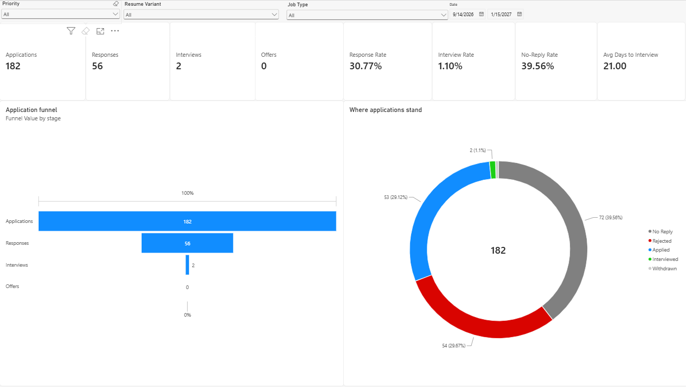
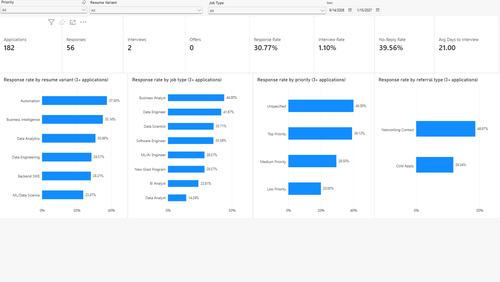
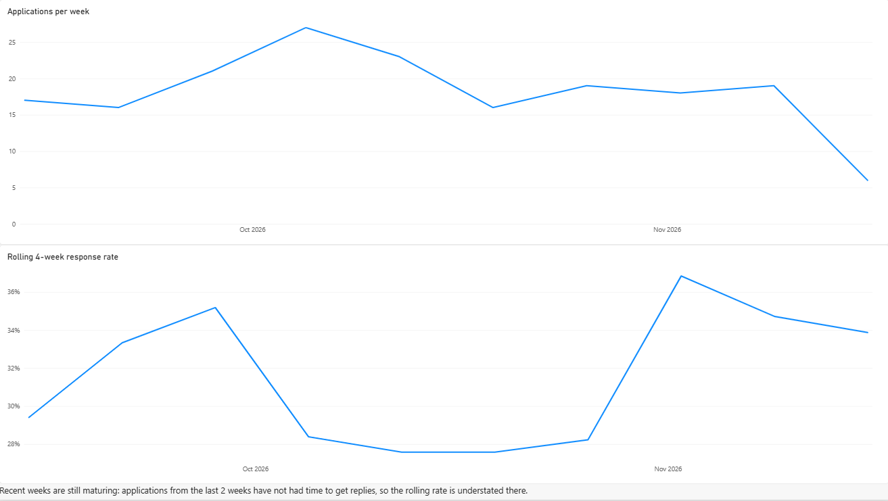

# Job Search Intelligence Platform

[](https://github.com/TomasNader7/job-tracker/actions/workflows/ci.yml)

A personal job-search tracker built in stages: a Power BI dashboard, a small local web app that records every status change as history, and (planned) a Databricks pipeline feeding the dashboard. This repo ships **synthetic data only**. The real tracker, its database and its dashboard stay private on one machine.

## Roadmap

| Phase | What | Status |
|---|---|---|
| 0 | Power BI dashboard on a star schema (Funnel, Performance, Timeline pages) | Done |
| 1 | Databricks Free Edition feasibility spike (synthetic data only) | Done, see [the spike note](docs/phase1-databricks-spike.md) |
| 2 | ASP.NET Core app with an append-only status history | Feature-complete, tests run in CI |
| 3 | Synthetic end-to-end slice: seeded demo database, versioned snapshot, Databricks bronze/silver/gold, reconciled and rerun-safe | Done, see [the Phase 3 note](docs/phase3-end-to-end.md). Power BI refresh against the new gold table still to be confirmed |
| 4 | Excel import and data-quality hardening | Planned |
| 5 | Power BI integration and public release | Planned |

The app runs **locally only**. It is not deployed anywhere.

## The app (Phase 2)

A small ASP.NET Core Razor Pages app on a local SQL Server (LocalDB) database. It lists applications, shows each one's history, and lets you add applications, change status and correct mistakes.

### Design rules

- **History is append-only.** A status change adds a row to `StatusEvents`. Rows are never edited or deleted. The current status is *projected* from the history, never stored.
- **Mistakes are fixed by correction.** A correction is a new row that replaces the wrong one. It needs a note. The wrong row stays in the history, shown struck out.
- **Status rules live in one place.** `StatusTransitions` defines the allowed moves. No step skipping (Applied cannot jump to Accepted). Withdrawn and Accepted are final. Rejected can only be reopened to Interview Scheduled.
- **No Reply is derived, not stored.** An application is "No Reply" when its status is Applied and more than 30 days have passed. A late reply is just a normal status change.
- **Bad history is reported, not hidden.** If a history is inconsistent, the projection stops at the last valid status and lists the problems. A change that would break the history is refused before it is saved.
- **Database refuses orphans.** Every event must belong to a real application, and an application with history cannot be deleted.

### Layout

| Project | Role |
|---|---|
| `src/JobTracker.Domain` | The rules: statuses, transitions, events, projection. No database code |
| `src/JobTracker.Data` | EF Core `DbContext`, migrations, `ApplicationService` (the one place screens call) |
| `src/JobTracker.Web` | Razor Pages: list, add, detail with change-status, correct |
| `tests/JobTracker.Tests` | xUnit tests (rules, database, service, pages) |

### Run it

Needs the .NET 9 SDK and SQL Server LocalDB (Windows).

```
dotnet tool restore
dotnet ef database update --project src/JobTracker.Data    # creates the local JobTracker database
dotnet run --project src/JobTracker.Web                    # http://localhost:5158
```

The database file lives in your Windows user folder, not in the repo. Anything you add is real data in that local file, so use made-up companies if you are only trying it out.

### Test it

```
dotnet test
```

The database tests build throwaway databases (`JobTracker_Test*`) from the migrations and delete them afterward. They never touch the `JobTracker` database. GitHub Actions runs the same tests on every push, on a Windows runner because LocalDB is Windows-only.

## Synthetic demo lane (Phase 3)

The app's history can be exported as a versioned snapshot and run through Databricks, where the status of every application is **recomputed independently** from the events and reconciled against what the app computed. Synthetic data only: the tools refuse any database but `JobTracker_Demo`, and the uploader refuses anything that is not a clean synthetic snapshot before the Databricks CLI is called.

```
dotnet run --project src/JobTracker.Tools -- seed-demo --reset
dotnet run --project src/JobTracker.Tools -- export-snapshot
python scripts/upload_snapshot.py snapshots/<snapshot_id>
python scripts/verify_databricks_run.py snapshots/<snapshot_id>
```

The contract between the two sides is [docs/snapshot-contract.md](docs/snapshot-contract.md). Results and limits are in [docs/phase3-end-to-end.md](docs/phase3-end-to-end.md). Python tests: `python -m unittest discover -s scripts/tests` (the Spark tests need `pip install pyspark==3.5.3` and Java 17, and are skipped without them).

## Power BI dashboard (Phase 0)

A Power BI dashboard over a job-search pipeline: funnel conversion, performance by resume variant, job type, priority and networking vs cold apply, and a weekly timeline. The numbers below come from **synthetic data**, calibrated to the shape of a real tracker.

Status: complete. All 12 cards match the recomputed values and the Excel PivotTable on the real data (private, 186 applications as of 2026-11-17). Funnel, Performance and Timeline pages are done.

### Dashboard (synthetic data)

Screenshots below come from the synthetic dataset. Company names are fabricated, and the shapes (including the weekly rate) are not meant to match any real results. All DAX is in `powerbi/measures.dax`.

**Funnel**: applications, responses, interviews and offers, plus where every application stands.



**Performance**: response rate by resume variant, job type, priority and referral type (groups with 3+ applications only).



**Timeline**: applications per week and a rolling 4-week response rate (replies divided by applications over the 28 days ending each week). Recent weeks are understated because replies are still arriving, and the first weeks cover less than 4 weeks of data.



### Two datasets, one model

| | Synthetic (public) | Real (private) |
|---|---|---|
| Script | `scripts/generate_synthetic.py` | `scripts/build_real.py` |
| Output | `data/synthetic/` (committed) | `data/real/` (git-ignored) |
| Content | fabricated companies, titles, dates | the real tracker, read-only |

Both write the identical star schema through `scripts/starschema.py`, so one Power BI model works for either: point the six queries at the other folder and refresh.

| Table | Role |
|---|---|
| `fact_application` | one row per application |
| `dim_status` | status plus 1/0 flags: is_application, is_response, is_interview, is_offer, is_rejection, is_no_reply |
| `dim_resume_variant`, `dim_job_type`, `dim_priority` | slicer dimensions |
| `dim_date` | calendar, joined on applied date |

```
python scripts/generate_synthetic.py --xlsx   # --xlsx adds a git-ignored flat Excel copy (tracker_flat.xlsx) for PivotTable checks
python scripts/build_real.py --xlsx           # real data; needs the real tracker file
python scripts/verify_measures.py data/synthetic   # recomputes every measure from the CSVs; must print PASS
```

### Data-prep rules (both datasets)

- **No Reply:** the tracker keeps silent applications as "Applied". Applied for more than 30 days counts as "No Reply".
- **Job type** (real data): derived from keywords in the job title, because the raw "Type of Job" column is inconsistent.
- **Blank priority or resume variant:** "Unspecified".
- **Networking Contact:** the referral/networking column is filled. Otherwise "Cold Apply". Includes outreach that was drafted or sent, not only confirmed referrals.
- **Excluded:** rows that are outreach with no posting.
- **Withdrawn:** counts as an application, with no response flag.

### Build the model in Power BI Desktop

1. Home > Get data > Text/CSV. Load all six CSVs from `data/synthetic/` (not `expected_measures.json` or the xlsx).
2. In `fact_application`, set `date_applied` and `interview_date` to type **Date**; in `dim_date`, set `date` to Date.
3. Model view. Create relationships (many-to-one, single direction):
   - `fact_application[status_key]` to `dim_status[status_key]`
   - `fact_application[resume_variant_key]` to `dim_resume_variant[resume_variant_key]`
   - `fact_application[job_type_key]` to `dim_job_type[job_type_key]`
   - `fact_application[priority_key]` to `dim_priority[priority_key]`
   - `fact_application[date_key]` to `dim_date[date_key]`
   - Leave `interview_date_key` unrelated (the measures use `interview_date` directly).
4. In `dim_date`, mark as date table on `date`; sort `month_name` by `month_number`.
5. Paste each measure from `powerbi/measures.dax` (Modeling > New measure).
6. Format the rate measures as percentage, Avg Days to Interview as one decimal.

### Measure definitions

- **Applications**: rows whose status counts as submitted (everything except Not Started).
- **Response**: any reply, including rejection (Rejected, Interview Scheduled, Interviewed, Accepted).
- **Interview**: Interview Scheduled, Interviewed, Accepted.
- **No Reply**: status is "No Reply" (see the 30-day rule above).
- Rates divide by Applications. Avg Days to Interview uses only rows with an interview date.

### Reconciliation (expected values, synthetic data)

Cards in Power BI (no slicers) must equal `data/synthetic/expected_measures.json` and the PivotTable on `tracker_flat.xlsx`:

| Measure | Expected |
|---|---|
| Applications | 182 |
| Responses / Rejections / Interviews / Offers / No Replies | 56 / 54 / 2 / 0 / 72 |
| Response / Interview / Offer / Rejection / No-Reply rate | 30.8% / 1.1% / 0.0% / 29.7% / 39.6% |
| Avg Days to Interview | 21.0 |

PivotTable check: Rows = application_status, Values = count of application_id. The counts must add up to the measures above.

## Privacy

`.gitignore` blocks `*.xlsx` and `data/real/`. The real tracker holds company names, contact emails and LinkedIn links and is never committed. The synthetic files contain only fabricated names ("Company 001") and aggregate-level calibration.

The app's database is a LocalDB file in the user's Windows folder, outside this repo, and its connection string has no credentials (Windows login). Only the migration recipe is committed, never data. Anything sent to Databricks Free Edition must be synthetic, because that tier may be used to train Databricks services.
